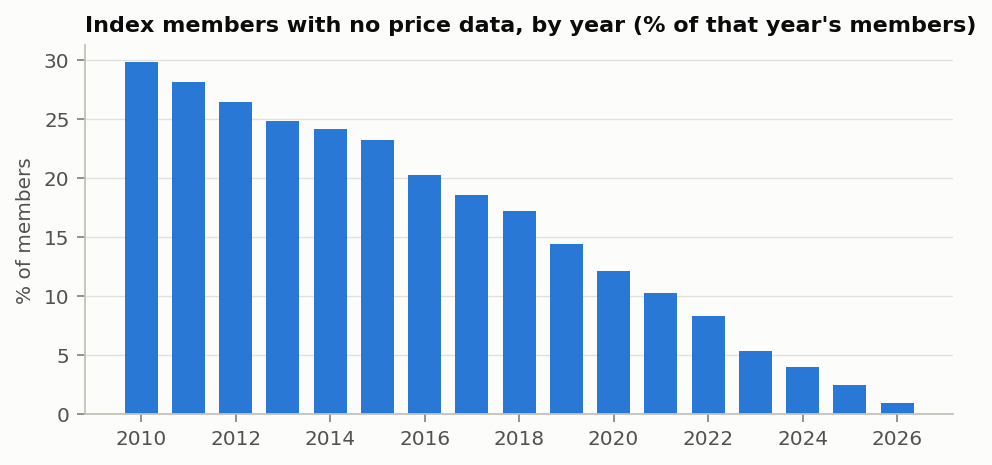
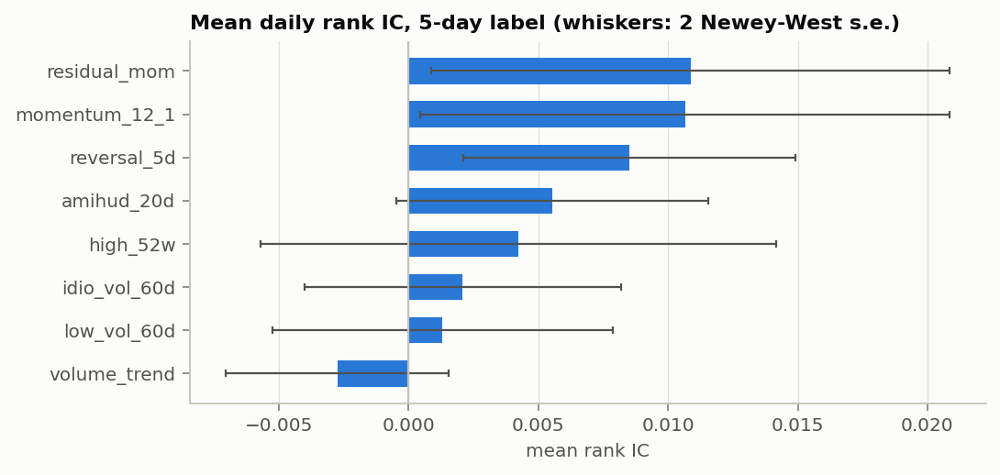
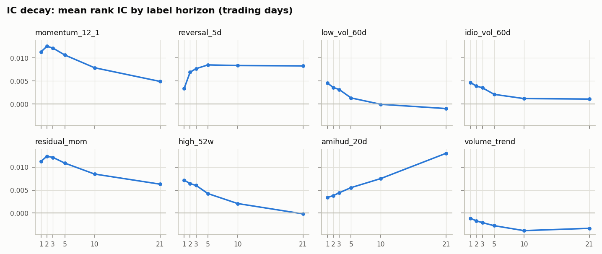
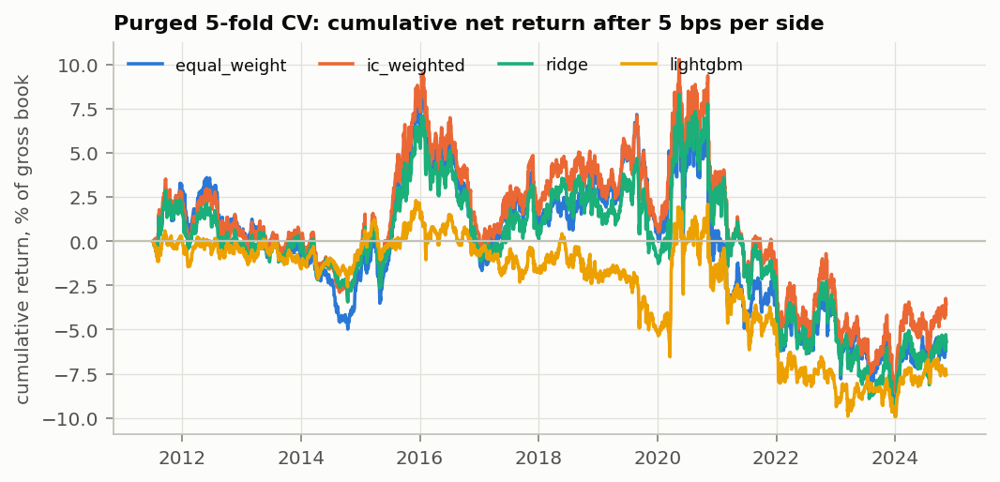
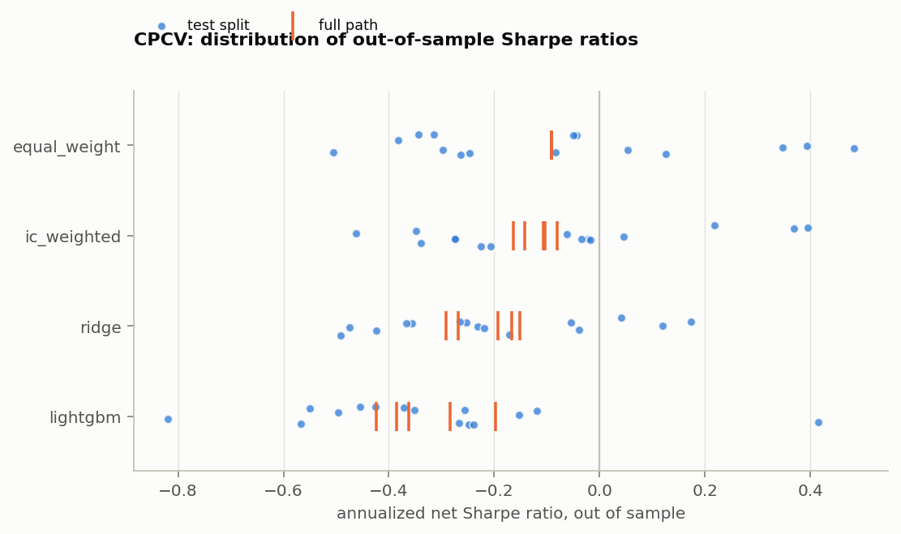
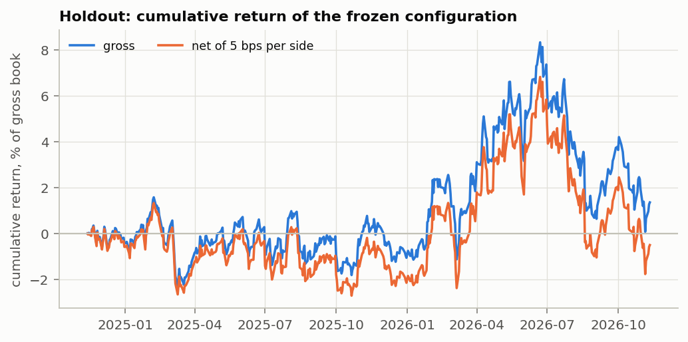

# Do simple price and volume signals survive leak-free validation?

*Generated by `src/report/writeup.py` from the files in `reports/tables`. Every number comes from the code.*

## 1. Question

Do eight simple price and volume signals predict the cross-section of forward returns in US large caps after costs? Does a combination of them survive purged cross-validation and a multiple-testing correction? The goal is an honest answer, not a large Sharpe ratio.

## 2. Data and limitations

- Daily adjusted prices and volume from yfinance, 2010-01-04 to 2026-11-11 (4,241 trading days).
- Universe: S&P 500, with point-in-time membership rebuilt by walking the index change log back from today's Wikipedia list. 853 tickers were members at some point. A stock is only traded while it is a member.
- **Survivorship bias.** 206 of 853 historical members (24.2%) have no data on yfinance. These are mostly delisted or acquired names. The share of a year's members with no data ranges from 0.9% to 29.8% (worst year: 2010, Figure 1). Results are biased by this, most likely upward for anything that buys distressed stocks.
- The change log does not fit the rebuilt membership in 0 events (renamed or recycled tickers). They are listed in `tables/membership_inconsistencies.csv`.
- Wikipedia no longer shows the change log on the live article. Membership history comes from: GitHub dataset fja05680/sp500 (historical member lists), up to 2026-08-18. The 14 changes after that date are approximated: additions use the 'Date added' column, removals are dated at the last addition.
- Sectors are today's GICS sectors, not point-in-time. 144 tickers that left the index have no sector and are grouped as Unknown.
- Cleaning: 234 one-day returns above 50% in absolute value were flagged, of which 36 looked like unadjusted splits and were repaired. 11,262 zero-volume days and 44 missing days were found. Prices are never forward-filled.
- Liquidity filter, past data only: price at least $5 and 20-day median dollar volume at least $10M. It removes 1.2% of member-days. On average 406 stocks are tradable per day.
- Split: research set to 2024-11-11; final holdout from 2024-11-12 (the last 24 months). The loader cuts the holdout off unless an explicit flag is passed.

## 3. Signals

Timing: a signal for day t uses data up to the close of t. The position is entered at the close of t+1. The label is the return from close t+1 to close t+1+h, demeaned across stocks, with h = 5 days. Each signal is winsorized, ranked, mapped to z-scores, and neutralized against sector dummies and market beta, per date. Signs were fixed in advance from the literature.

Single-signal results on the research set, 2011-07-05 to 2024-11-11 (t-statistics use Newey-West errors with 10 lags):

| Signal | Mean IC | ICIR | NW t | Quintile monotonicity | Autocorr 5d | Daily turnover | Net Sharpe (5 bps) |
|---|---|---|---|---|---|---|---|
| momentum_12_1 | 0.0107 | 0.070 | 2.09 | 0.600 | 0.968 | 0.044 | -0.04 |
| reversal_5d | 0.0085 | 0.081 | 2.66 | 0.900 | -0.015 | 0.283 | -0.48 |
| low_vol_60d | 0.0013 | 0.013 | 0.40 | -0.600 | 0.946 | 0.048 | -0.33 |
| idio_vol_60d | 0.0021 | 0.023 | 0.69 | -0.700 | 0.950 | 0.045 | -0.36 |
| residual_mom | 0.0109 | 0.074 | 2.18 | 0.600 | 0.969 | 0.045 | 0.02 |
| high_52w | 0.0042 | 0.029 | 0.85 | -0.700 | 0.896 | 0.082 | -0.42 |
| amihud_20d | 0.0055 | 0.062 | 1.84 | 0.700 | 0.986 | 0.030 | 0.31 |
| volume_trend | -0.0027 | -0.042 | -1.28 | -0.300 | 0.851 | 0.095 | -0.59 |

## 4. Validation method

- **Purged K-fold** (5 folds, split by date). A 5-day label overlaps its neighbours, so training dates within 5 days of a test fold are removed, plus a 5-day embargo after it.
- **CPCV** with 6 groups and 2 test groups: 15 splits and 5 full backtest paths. This gives a distribution of out-of-sample Sharpe ratios.
- **Probabilistic Sharpe ratio (PSR)**: the probability that the true Sharpe is above a benchmark, allowing for sample length, skew and fat tails.
- **Deflated Sharpe ratio (DSR)**: PSR against the Sharpe that the best of N zero-skill trials would be expected to show. Every configuration ever evaluated is logged in `trials.jsonl` (29 distinct configurations, 29 evaluations).
- **PBO**: how often the in-sample best trial falls below the median out of sample.
- **Holdout**: one frozen configuration, run once. A fitted model replaces equal weighting only if it beats it in purged CV with a t-statistic of at least 2.0. This rule was fixed in the config beforehand.
- All of this is implemented from scratch and covered by tests (lookahead, purge, timing, null, planted signal, PSR and DSR against hand-computed values, universe).

## 5. Results

**Combination models, purged CV, net of 5 bps per side.** Best grid point per family:

| Model | Params | Gross Sharpe | Net Sharpe | Net ann. return | Max drawdown | Daily turnover | Break-even bps | CPCV mean | CPCV s.d. | CPCV share > 0 |
|---|---|---|---|---|---|---|---|---|---|---|
| equal_weight | {} | 0.11 | -0.09 | -0.4% | -18.4% | 7.5% | 2.8 | -0.08 | 0.30 | 33% |
| ic_weighted | {} | 0.18 | -0.06 | -0.3% | -18.8% | 9.0% | 3.8 | -0.08 | 0.26 | 27% |
| ridge | {'lam': 10.0} | 0.28 | -0.10 | -0.4% | -18.1% | 13.0% | 3.7 | -0.20 | 0.21 | 20% |
| lightgbm | {'n_estimators': 100, 'max_depth': 2} | 0.55 | -0.18 | -0.6% | -12.2% | 18.4% | 3.8 | -0.33 | 0.27 | 7% |

**The complex models do not reliably beat equal weighting.** The best CV model is ic_weighted (net Sharpe -0.06 against -0.09 for equal weight), but the difference has a t-statistic of only 0.40, below the threshold of 2.0. Equal weight was frozen.

Equal weighting fits nothing, so its CPCV paths are identical. Its spread across test splits shows variation across time periods only.

**Frozen configuration (equal_weight), research set versus holdout:**

| Metric | Research set (purged CV) | Holdout (single run) |
|---|---|---|
| Sharpe, gross | 0.11 | 0.11 |
| Sharpe, net | -0.09 | -0.04 |
| Ann. return, net | -0.4% | -0.3% |
| Ann. vol | 4.7% | 6.4% |
| Max drawdown | -18.4% | -8.6% |
| Daily turnover | 7.5% | 7.4% |
| Break-even cost (bps/side) | 2.8 | 3.6 |
| Market beta | -0.04 | 0.02 |
| Days | 3361 | 500 |

**Costs.** Net Sharpe by cost per side: 0 bps: 0.11, 2 bps: 0.03, 5 bps: -0.09, 10 bps: -0.29, 20 bps: -0.70. Break-even cost is 2.8 bps per side.

**Multiple testing.** PSR against zero is 0.369. The trial Sharpe ratios imply an expected maximum annualized Sharpe of 0.76 under the null with raw N = 29, and the DSR is 0.001. The trials are correlated (average correlation 0.34), so raw N overstates the number of independent bets. With effective N = 19.4 (average-correlation estimate) the DSR is 0.002; with effective N = 2.9 (eigenvalue estimate) it is 0.071. The two effective-N estimates differ a lot, so the DSR is best read as a range. It is also conservative: the variance of trial Sharpe ratios includes real differences between signals, not only noise. PBO is 0.06 over 252 splits.

**Robustness.** Equal weight at other horizons, net Sharpe: h = 1: -0.31, h = 21: -0.01. Net Sharpe of the frozen model by year ranges from -1.70 (2016) to 2.02 (2015); it is positive in 5 of 14 years. IC by year and by sector is in `tables/ic_by_year.csv` and `tables/ic_by_sector.csv`.

**Holdout.** One run, 2024-11-12 to 2026-11-11 (holdout loads logged: 1). Net Sharpe -0.04 against -0.09 in CV. Mean daily IC of the combined score 0.0074 (Newey-West t = 0.57). PSR against zero 0.478. With 500 days, the standard error of an annualized Sharpe is about 0.71, so the holdout can only confirm or reject large effects.

## 6. What did not work

- 5 of 8 signals have an IC that is not significant at |t| < 2: low_vol_60d, idio_vol_60d, high_52w, amihud_20d, volume_trend.
- Signals with a significant IC of the opposite sign to the prior: 0.
- 6 of 8 single-signal portfolios lose money after 5 bps per side: momentum_12_1, reversal_5d, low_vol_60d, idio_vol_60d, high_52w, volume_trend.
- Ridge and LightGBM did not earn their complexity over an equal-weight average (table above).
- The deflated Sharpe ratio with raw N is 0.001, below the usual 0.95 bar. After correcting for the number of trials, the result is not statistically convincing.
- Holdout net Sharpe is 0.05 above the CV estimate. Nothing was tuned after seeing it.

## 7. Next steps

- Replace yfinance with a survivorship-free source (CRSP or similar) to remove the main data limitation.
- Use point-in-time sectors and an explicit risk model instead of sector dummies plus one beta.
- Model costs as a function of spread and volatility, and add a turnover penalty to the portfolio step.
- Test on other universes (mid caps, Europe) as a true out-of-sample check of the same frozen pipeline.
